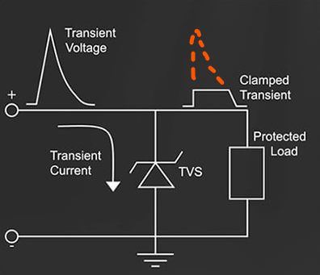
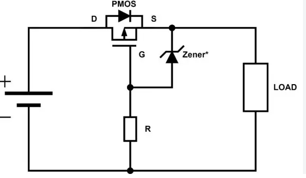

---
date:
  created: 2026-11-10
categories:
  - circuit
  - electronique
tags:
  - circuit
  - electronique
authors:
  - thomas
slug: circuit_electronique 
---

# Circuits électroniques

Présentation de divers composants de circuit électroniques

<!-- more -->

## Diode TVS  

Il s'agit d'une diode dédiée à la protection des pics de courant. Son acronyme signifie Transient Voltage Suppression. Un courant transient, transitoire en français, est un courant temporaire qui circule dans un circuit lors d'une période de transition, C'est donc un changement abrupte du courant sur une courte durée, il survient quand le système subit une pertubation (ex: fermeture d'un interrupteur, variation de charge, electricité statique).  
Cette diode spéciale laisse passer le courant dans un sens jusqu'à une certaine tension.
Lorsque la tension dépasse une certaine limite, nommée tension de claquement, la diode laisse passer le courant dns l'autre sens. On s'en sert pour rediriger l'exes vers le GND, préservant ainsi le reste du circuit.
L'exces de tension est dissipé sous forme de chaleur par la diode TVS.  

   

A gauche le symbol représentant une diode TVS dans le domaine du courant continu, a droite l'alternatif.  
   

Reverse Standoff Voltage = seuil en dessous duquel la diode TVS ne va pas changer de sens. Cette valeur doit être un peu plus haut que le signal afin de ne pas corrompre ce dernier.  
Breakdown voltage = seuil à partir duquel la diode TVS absorbe tout le courant qu'elle peut absorber (sa courbe d'absorbtion ne passe pas de 0 à 100% abruptement).
Clamping voltage = tension maximum que le reste du circuit subit lors d'un pic quand la diode TVS est active. Doit être inférieur à la tension qui détruirait les composants.  
Capacitance = le "délais" généré dans les changements de tension par l'action de la diode TVS. Comme elle émousse le signal high-low il faut s'assurer que sa valeur ne le corrompe pas au point de ne plus être lisible.

En français ces termes sont:
tension de blocage inverse  
Puissance de crête  
tension de blocage    
capacité
  

il existe 2 types de montages : avalanche et array...

La diode TVS ressemble à une diode Zener, voici un tableau différenciant leur fonctionnement:  

|   | Diode Zener | Diode TVS |
| :--- | :--- | :--- |
| **Fonction principale** | Fournir une **tension de référence stable** ou réguler une tension d'alimentation. | **Absorber et écrêter** (*clamping*) les pics de tension violents et transitoires. |
| **Mode d'action** | **Continu** : elle conduit en permanence une partie du courant pour maintenir un palier de tension fixe. | **Ponctuel** : Ne s'active qu'en cas d'urgence (surtension). |
| **Temps de réponse** | Moins rapide que la diode TVS, peut générer du bruit sur un signal. | **Ultra-rapide** (de l'ordre de la picoseconde à la nanoseconde) pour couper net les pics. |
| **Capacité en puissance** | Faible à moyenne (adaptée pour dissiper de la chaleur en continu, ex: 0.5W à 5W). | **Très élevée en crête** (capable d'encaisser des kilowatts pendant quelques microsecondes). |
| **Impact sur le circuit** | Fixe le niveau haut d'un signal ou stabilise une alimentation. | Protège l'électronique sensible (microcontrôleurs, ports USB) contre l'ESD et la foudre. |

## Protection reverse polarity

Circuit de protection contre les mauvais sens de branchement. Utile pour prévenir un branchement d'une battterie où autre composant ayant un VCC et GND. Permet d'éviter la casse en qu'en cas de mauvais branchement (VCC sur GND).

Il s'agit d'un Mosfet placé en série sur l'alimentation. On peut y ajouter une diode Zener afin de protéger la gate du mosfet.
   