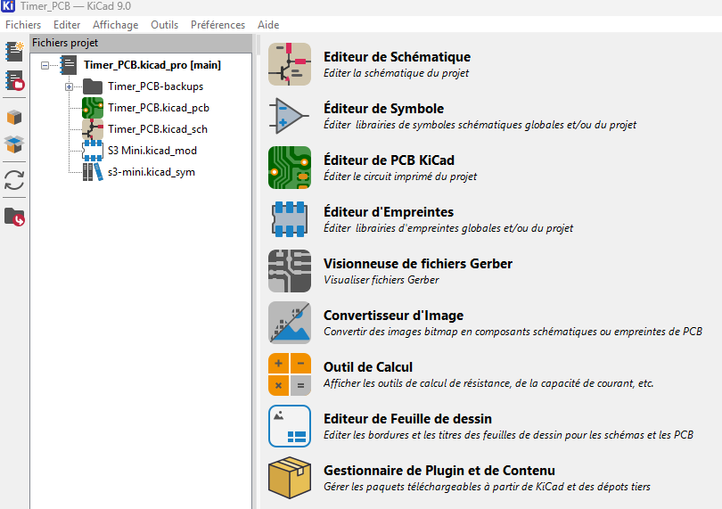

---
date:
  created: 2026-11-10
categories:
  - circuit
  - electronique
tags:
  - circuit
  - electronique
authors:
  - thomas
slug: circuit_electronique 
---

# Circuits électroniques

Présentation de divers composants de circuit électroniques

<!-- more -->

## Diode TVS  

Il s'agit d'une diode dédiée à la protection des pics de courant. 
Cette diode spéciale laisse passer le courant que lorsque sa tension dépasse une certaine limite

 

## Protection reverse polarity

